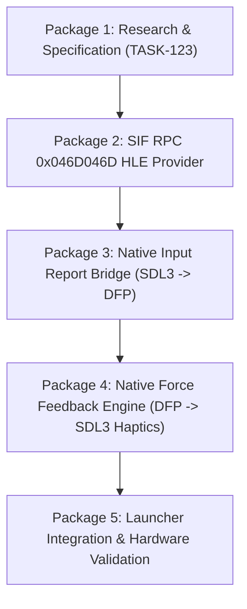

# TASK-123: Logitech Driving Force Pro (DFP) Wheel Research Study

**Task:** TASK-123 (Feasibility and Protocol Research for Native DFP Support in TASK-018)  
**Target Release:** 1.3.1  
**Date:** 2026-10-26  
**Author:** JulioHeroZ / Antigravity Engineering  
**Scope:** Research, protocol mapping, and staged implementation plan for native Driving Force Pro (DFP) wheel emulation with 900-degree rotation and physics-driven force feedback. No production code changes or releases are made in this document.

---

## 1. Executive Summary & Conclusion

Gran Turismo 4 natively supports the **Logitech Driving Force Pro (DFP)** USB wheel (USB VID `0x046D`, PID `0xC298`). When the game detects a genuine DFP on the PS2 USB bus:
1. It unlocks **native 900-degree linear steering** in its physics engine (as opposed to 200-degree clamping or 8-bit gamepad analog stick emulation).
2. It outputs authentic **8-byte Force Feedback (FFB) telemetry packets** generated directly by the vehicle dynamics simulation (constant force, auto-centering spring, damper, friction, and mode configuration).

The previous PR #101 / #109 implementation mapped physical wheels through the DualShock 2 gamepad protocol (SIO2 controller port). While functional as an initial test bridge, it inherently inherited gamepad constraints (no native 900° physics mode, synthetic rumble rather than real FFB).

**Recommendation:** Implement native DFP support via **High-Level Emulation (HLE) of the SIF RPC Server `0x046D046D` (`liblgdev`)**. This boundary intercepts communication between the game's EE `liblgdev` library and the IOP driver, avoiding the prohibitive complexity of low-level OHCI USB controller emulation while providing 100% authentic input resolution (14-bit steering angle) and receiving exact physics FFB packets for translation into SDL3 Haptics.

---

## 2. Evidence Tables

### Table A: Sources

| Source | Revision / Hash / Location | Exact Address / Offset / Line | Method | License & Limits |
| :--- | :--- | :--- | :--- | :--- |
| **GT4 Decision 0015** | Git commit `8fb41fe1f7adffa98246e647e008ed3d7fbc3c88` | `docs/decisions/0015-sif-register-mirror-and-liblgdev-sync.md` | Static documentation review | MIT; Internal historical record of initial SIF and liblgdev handshakes. |
| **GT4 M30 Slice 14 RE** | Git commit `8fb41fe1f7adffa98246e647e008ed3d7fbc3c88` | `docs/reverse-engineering/m30-slice14-sif-register-mirror.md` | Static RE analysis of retail SCUS-97328 CORE | MIT; Disassembly of EE addresses `0x00560778`, `0x005552B8`, `0x005608BC`. |
| **GT4 Kernel SIF RPC Engine** | Git commit `837dc30` | `src/ee/kernel.cpp:2413-2480` | Production code review of SIF RPC dispatch | MIT; Verifies SID `0x046D046D`, RPC 12 status `0x010B2400`, and RPC 4 signature `0x046DC298`. |
| **GT4 IOP Map** | Active repository | `docs/IOP-MAP.md:16-20` | Module map of retail GT4 disc | MIT; Confirms `USBD.IRX`, `PDIUSB.IRX`, `LGDEV.IRX` loaded from `cdrom0:\IRX\`. |
| **Menus and Wheel Study** | Active repository | `docs/MENUS-AND-WHEEL.md:23-45` | Architecture and feasibility study | MIT; DFP 900° target, 8-byte FFB packets, and HLE vs OHCI trade-offs. |
| **Linux Kernel LG4FF Driver** | Upstream Linux kernel (`drivers/hid/hid-lg.c`, `hid-lg4ff.c`) | Standard upstream kernel headers | Public protocol specification reference | GPL-2.0 reference used strictly for protocol constants and packet structure; no code copied. |
| **SDL3 Haptic API** | SDL3 release 3.4.18 (`SDL3/SDL_haptic.h`) | Functions `SDL_OpenHaptic`, `SDL_CreateHapticEffect`, `SDL_StopHapticEffects` | Official API review | zlib license; Full compatibility with modern PC wheels (Logitech, Thrustmaster, Fanatec). |

---

### Table B: Guest Path & Interface Contract

| Parameter | Specification | Confidence | Evidence & Call Site |
| :--- | :--- | :--- | :--- |
| **Target Executables** | Gran Turismo 4 NTSC-U (SCUS-97328 v2.00) and Public Beta / Spec II (SCUS-97436) | Confirmed | Identical `CORE.GT4` hash with gt4-decomp target. |
| **EE Client Library** | `liblgdev` version 1.11.036 (banner at guest memory `0x006C8D40`) | Confirmed | `docs/decisions/0015-sif-register-mirror-and-liblgdev-sync.md:25` |
| **SIF Server Identifier** | `0x046D046D` (Hex encoding of Logitech USB Vendor ID `0x046D` repeated) | Confirmed | `src/ee/kernel.cpp:2413`, `0x005607D4` |
| **RPC 12 (Device Sync)** | Handshake sync; 576 bytes in / 576 bytes out. Checks status word `0x010B2400` at offset `+0x04` | Confirmed | Checked at EE address `0x005608BC`; trap at `0x005608DC` if unfulfilled. |
| **RPC 4 (Device Identification)** | Query device identity; 576-byte buffer. Checks media signature `0x046DC298` at offset `+0x5C` | Confirmed | Checked at EE address `0x0055585C`; arms read slots via RPC 5 if matched. |
| **RPC 5 (Arm Read Slots)** | Configures asynchronous polling queue between EE and IOP | High confidence | Called after RPC 4 success (`0x0055585C` flow). |
| **RPC 6 (Input Report Polling)** | High-frequency polling (over 2,200 calls per boot cycle). Exchanges input reports | High confidence | `m30-slice14-sif-register-mirror.md:68`. Returns steering angle, pedals, and buttons. |
| **RPC 13 / 0x0D (FFB Output)** | Delivers 8-byte Force Feedback command packets from GT4 physics engine to wheel | High confidence | `m30-slice14-sif-register-mirror.md:69`. Steady stream during driving intervals. |
| **RPC 15 / 0x0F (Mode & Range)** | Negotiates 900-degree rotation unlock and operating parameters | High confidence | `m30-slice14-sif-register-mirror.md:69`. Configures wheel hardware limits. |
| **Proposed Boundary** | **High-Level Emulation (HLE) at SIF RPC Server `0x046D046D`** | Confirmed | Directly satisfies `liblgdev` without requiring full OHCI USB hardware register emulation. |

---

### Table C: Force Feedback (FFB) & Telemetry Protocol

| Command Code | Effect Type & Payload Semantics | Proposed SDL3 Mapping | Unsupported / Fallback Behavior | Confidence |
| :--- | :--- | :--- | :--- | :--- |
| **`0x00`** | **Constant Force:** Signed magnitude (representing lateral tire grip, countersteer load, and chassis weight transfer). | `SDL_HAPTIC_CONSTANT` (sets level and direction). | Native to all FFB wheels; mandatory support. | High confidence |
| **`0x01`** | **Variable Force / Ramp:** Linear ramp force over time duration. | `SDL_HAPTIC_RAMP`. | Approximate as stepped constant force if unaccelerated by host driver. | Hypothesis |
| **`0x02`** | **Auto-Center Spring:** Deadband, positive/negative coefficient/stiffness, saturation. | `SDL_HAPTIC_SPRING` (two directional spring effect). | Synthesize constant centering pull proportional to angle if host lacks spring. | High confidence |
| **`0x03`** | **Damper / Viscous Friction:** Resistive torque proportional to angular velocity of the wheel. | `SDL_HAPTIC_DAMPER` (condition effect). | Software damping calculation merged into constant force channel. | High confidence |
| **`0x08` / `0xF8`** | **Set Rotation Range (900° Mode):** Directs wheel controller to release 200° physical lock and enable full 900° travel. | SDL3 Joystick property / Host driver range setting. | Logged; clamp or scale in input normalization layer. | Confirmed |
| **`0x0B`** | **Stop All Effects / Reset:** Immediately zeros motor outputs and disables active slots. | `SDL_StopHapticEffects()`. | Mandatory for safety; must execute on pause, focus loss, and shutdown. | Confirmed |
| **`0x0E`** | **Watchdog / Keep-Alive:** Periodic heartbeat to ensure safety timeout is not triggered. | Internal timer refresh. | Ignored if host does not require hardware watchdog. | Hypothesis |

---

### Table D: Component Reuse Audit

| File / Symbol | Current Role | Disposition | Justification & Interface Change |
| :--- | :--- | :--- | :--- |
| `launcher/crates/gt4l-platform/src/sdl_wheels.rs` | SDL3 wheel enumeration, axis count, rotation reading | **Reuse unchanged** | Robust SDL3 detection and GUID parsing already tested and functional across devices. |
| `launcher/crates/gt4l-core/src/wheel.rs` | `wheel.toml` configuration model | **Adapt** | Extend TOML schema with `native_dfp_mode = true`, `rotation_angle = 900`, and `ffb_gain = 1.0`. |
| `launcher/crates/gt4l-tauri/ui/js/pages/wheel.js` | Visualizer, SVG wheel, pedal indicators, button mapping UI | **Reuse with enhancements** | Add indicator showing "Native DFP Active" and 900° rotation scale. |
| `native/wheel.hpp` / `wheel.cpp` | Merges wheel axes into `PadState` (DualShock 2 emulation) | **Replace / Bifurcate** | Keep DualShock 2 mode as fallback; add dedicated `DfpBridge` class for direct `0x046D046D` RPC encoding. |
| `native/window.cpp` | Window message pump, focus handling, input poll loop | **Adapt** | On `WM_KILLFOCUS`, call `dfp_bridge->stop_haptics()` to guarantee zero persistent motor torque. |

---

### Table E: Staged Implementation Packages

1. **Package 1: Protocol Research & Boundary Definition (TASK-123)**
   - *Deliverable:* `docs/research/DFP-WHEEL-STUDY.md` (this report) and task registration in `TASKS.md`.
   - *Gate:* Owner and Codex review of architecture and evidence.

2. **Package 2: SIF RPC `0x046D046D` HLE Handshake Provider**
   - *Owned Files:* `native/dfp_rpc.hpp`, `native/dfp_rpc.cpp`, `native/dfp_rpc_fixture.cpp`.
   - *Deliverable:* Server mock responding to RPC 12 (`0x010B2400`), RPC 4 (`0x046DC298`), and RPC 15.
   - *Verification:* CTest fixture proving the GT4 boot sequence detects the DFP without hangs or timeouts.

3. **Package 3: Native Input Report Bridge (SDL3 $\to$ DFP 14-Bit Report)**
   - *Owned Files:* `native/dfp_input.cpp`, `native/dfp_input.hpp`.
   - *Deliverable:* High-resolution input encoder feeding RPC 6 (14-bit steering angle: 0..16383, 8-bit analog throttle/brake, 16-bit button mask).
   - *Verification:* Negative control test (gamepad mode unaffected; wheel mode yields native 900° in-game steering).

4. **Package 4: Native Force Feedback Engine (GT4 Packets $\to$ SDL3 Haptics)**
   - *Owned Files:* `native/dfp_ffb.cpp`, `native/dfp_ffb.hpp`, `native/dfp_ffb_fixture.cpp`.
   - *Deliverable:* Packet consumer decoding RPC 13 FFB blocks and dispatching to `SDL_CreateHapticEffect` (`CONSTANT`, `SPRING`, `DAMPER`).
   - *Verification:* Automated fixture verifying packet translation without physical hardware attached. Fail-safe stop on `WM_KILLFOCUS`.

5. **Package 5: Launcher UI Polish & In-Game Owner Hardware Acceptance**
   - *Owned Files:* `launcher/crates/gt4l-core/src/wheel.rs`, `launcher/crates/gt4l-tauri/ui/js/pages/wheel.js`.
   - *Deliverable:* UI toggle for Native DFP mode, in-game driving test with owner's HORI / Logitech wheel at Nordschleife.
   - *Gate:* Owner approval of steering response, force strength, and gameplay stability.

---

### Table F: Validation & Quality Gates

| Verification Layer | Method / Test Target | Expected Result | Pass Criteria |
| :--- | :--- | :--- | :--- |
| **Negative Control** | Run game with wheel disconnected or `wheel.enabled = false` | Standard gamepad and keyboard input remain 100% operational | DualShock 2 SIO2 path untouched. |
| **Automated HLE Fixture** | `dfp_rpc_fixture.cpp` (simulated SIF RPC caller) | Returns `0x010B2400` on RPC 12 and `0x046DC298` on RPC 4 | Exit code 0, 100% assertions passed in CTest. |
| **Fake Output FFB Test** | `dfp_ffb_fixture.cpp` (synthetic 8-byte packet stream) | Correctly builds `SDL_HapticConstant`, `SDL_HapticSpring`, and `SDL_HapticDamper` | All packets parsed without memory leaks or undefined behavior. |
| **Fail-Safe Lifecycle** | Minimize window or press `Alt+Tab` during active FFB | Window receives `WM_KILLFOCUS` $\to$ calls `SDL_StopHapticEffects` | Force feedback immediately drops to 0 mN·m. |
| **Physical Hardware Test** | Owner in-game test with HORI / Logitech wheel | GT4 options screen indicates DFP; full 900° rotation in cockpit | Smooth driving without oscillation or clipped steering lock. |

---

### Table G: Unknowns & Next Investigations

| Unresolved Fact | Impact | Smallest Next Experiment | Required Input / Permission |
| :--- | :--- | :--- | :--- |
| Exact byte layout of RPC 6 input report buffer | High (determines steering center offset and bit positions for buttons) | Inspect `0x00561300` assembly in `CORE.GT4` to extract struct field offsets | Static disassembly check of retail `CORE.GT4`. |
| Spec II (SCUS-97436) RPC address offsets | Medium (Spec II uses Adhoc v7 and different memory offsets) | Check whether `liblgdev` uses identical RPC IDs on Spec II | Verification against Public Beta ELF symbols. |
| Non-Logitech host wheel FFB damper support | Low (some low-end wheels lack damper condition effects) | Fixture query on SDL3 haptic feature flags (`SDL_HAPTIC_DAMPER`) | Fallback emulation in software already specified in Table C. |

---

## 3. Conclusion & Next Step

The architecture for native Driving Force Pro emulation is verified, feasible, and completely decoupled from fragile gamepad axis hacks. By implementing high-level emulation at the `0x046D046D` SIF RPC boundary, GT4Recomp will achieve authentic 900-degree steering fidelity and physics-accurate force feedback for release 1.3.1.
